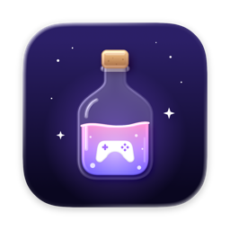
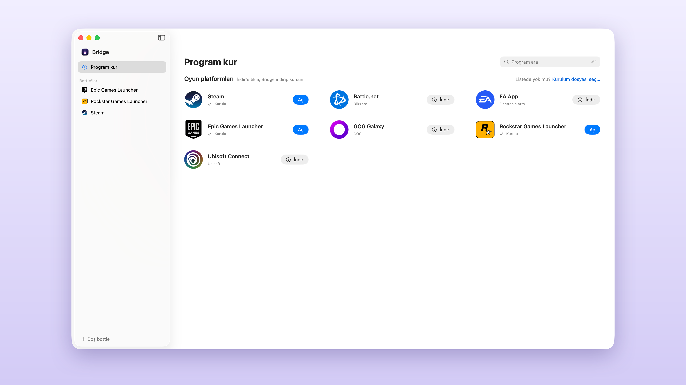
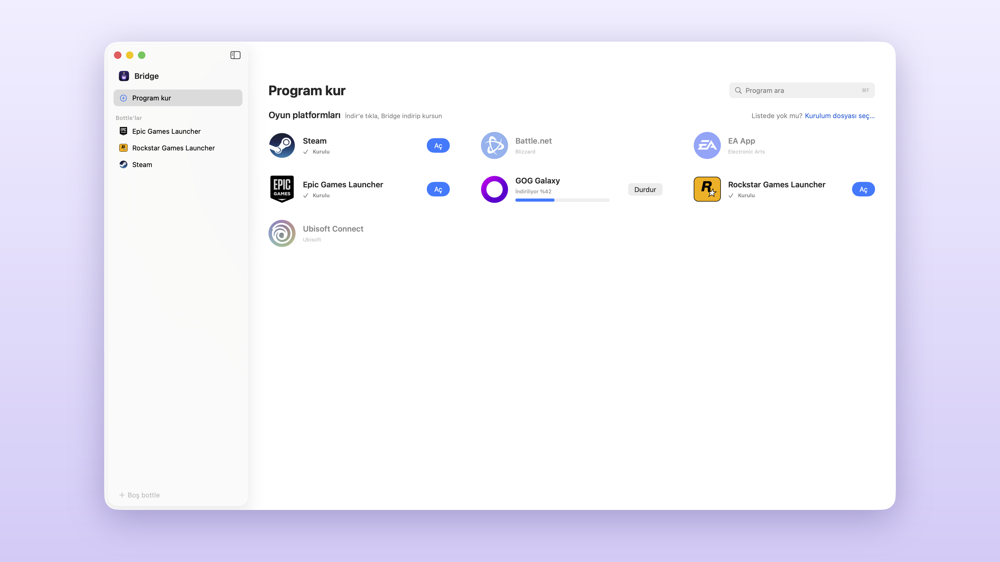
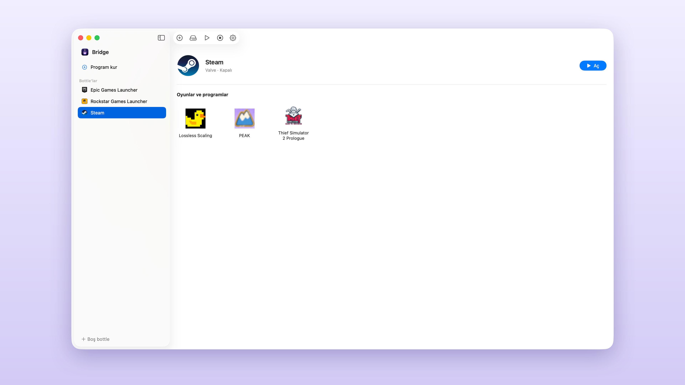
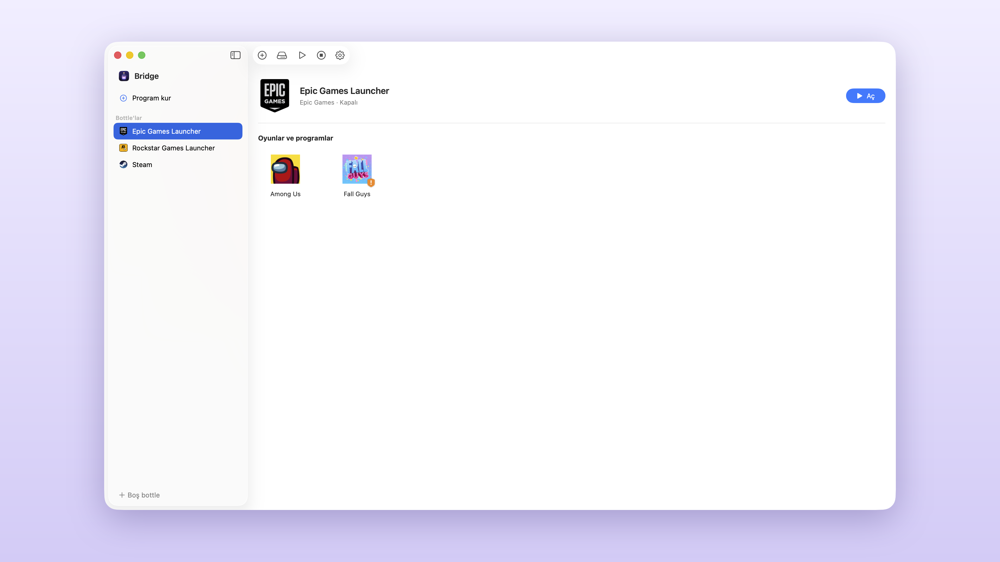

<p align="center">
  
</p>

<h1 align="center">Bridge</h1>

<p align="center">
  <strong>Windows oyunlarını ve programlarını Mac'te çalıştıran Türkçe uygulama.</strong><br>
  macOS 14+ · Apple Silicon · Wine tabanlı
</p>

<p align="center">
  <a href="https://github.com/UmutKaanTorun/Kopru/releases/latest"><strong>Son sürümü indir</strong></a>
</p>

<picture>
  <source media="(prefers-color-scheme: dark)" srcset="docs/screenshots/program-kur-dark.png">
  
</picture>

## Bridge nedir?

Bridge, Windows için yazılmış oyun platformlarını ve programları Mac'te çalıştırır. Arkada Wine çalışır, ama Wine'ı bilmeniz gerekmez: listeden bir platform seçip **İndir**'e tıklarsınız, Bridge indirir, kurar ve açılmaya hazır hâle getirir.

Her platform kendi **bottle**'ında durur. Bottle, içinde ayrı bir Windows ortamı (C: sürücüsü, kayıt defteri, ayarlar) olan bir klasördür. Bir platformdaki sorun ötekilere geçmez.

## Özellikler

- **Tek tıkla kurulum:** Steam, Epic Games, GOG Galaxy, Battle.net, EA App, Ubisoft Connect ve Rockstar Games Launcher hazır tariflerle kurulur.
- **Oyunlar tek yerde:** Bottle sayfası platformu üstte, kurduğunuz oyunları altında gerçek simgeleriyle gösterir. Bir oyunu Bridge'den doğrudan açabilirsiniz.
- **Hile koruması uyarısı:** EasyAntiCheat gibi hile koruması kullanan oyunlar işaretlenir; açmadan önce Bridge sorar.
- **Listede olmayan programlar:** Herhangi bir `.exe` ya da `.msi` kurulum dosyasını pencereye sürükleyin ya da "Kurulum dosyası seç…" ile gösterin.
- **Motor uygulamanın içinde:** Wine 11.0 + DXMT (Metal üzerinden DirectX 11) Bridge'in içinde gelir; ayrıca bir şey kurmanız gerekmez, yalnızca Rosetta.
- **Mac'e yakışan arayüz:** SwiftUI ile yazıldı. Açık ve koyu görünüme uyar, macOS 26'da Liquid Glass ile çizilir.

## Ekran görüntüleri

**İndirme ve kurulum:** İndirme platformun kendi satırında ilerler; bir kurulum sürerken öteki platformlar beklemede görünür.

<picture>
  <source media="(prefers-color-scheme: dark)" srcset="docs/screenshots/indiriliyor-dark.png">
  
</picture>

**Steam bottle'ı:** Steam'i başlıktaki **Aç** düğmesiyle, kurulu oyunları altındaki ızgaradan açarsınız.

<picture>
  <source media="(prefers-color-scheme: dark)" srcset="docs/screenshots/steam-dark.png">
  
</picture>

**Epic Games bottle'ı:** Epic'ten indirilen oyunlar da listede. Fall Guys'taki turuncu işaret, oyunun hile koruması kullandığını gösterir.

<picture>
  <source media="(prefers-color-scheme: dark)" srcset="docs/screenshots/epic-dark.png">
  
</picture>

## Desteklenen platformlar

| Platform | Durum |
|---|---|
| Steam | Çalışıyor: giriş, mağaza, oyun |
| Epic Games Launcher | Açılıyor: giriş, oyun indirme, oyun; arkadaş listesi çalışmıyor |
| Rockstar Games Launcher | Açılıyor: giriş, kitaplık, mağaza |
| GOG Galaxy | Açılıyor |
| Ubisoft Connect | Açılıyor |
| Battle.net | Açılıyor |
| EA App | Açılıyor |

"Açılıyor": Bridge'le kuruldu ve giriş ekranına kadar açıldığı görüldü. Hile koruması kullanan oyunlar büyük olasılıkla açılmaz: korumanın Wine modülü yalnızca Linux'ta çalışıyor.

## Kurulum

1. [Son sürümün](https://github.com/UmutKaanTorun/Kopru/releases/latest) `.dmg` dosyasını indirin, açın ve Bridge'i **Applications** klasörüne sürükleyin.
2. İlk açılışta macOS uyarır, çünkü uygulama henüz Apple tarafından onaylanmadı (notarization yok). Finder'da Bridge'e sağ tıklayıp **Aç**'ı seçin, ya da Sistem Ayarları → Gizlilik ve Güvenlik → **Yine de Aç**.
3. Rosetta gerekir. Yüklü değilse Bridge kurulum komutunu gösterir:

   ```bash
   softwareupdate --install-rosetta --agree-to-license
   ```

**Gereksinimler:** macOS 14 ya da üstü, Apple Silicon (M1 ve sonrası). Uygulama açıldığında yaklaşık 1,1 GB yer kaplar.

Bottle'lar `~/Library/Application Support/Kopru` klasöründe durur. Bridge'in eski adı Köprü'ydü; o sürümün bottle'ları olduğu gibi açılır.

## Kaynaktan derleme

Proje dosyası [XcodeGen](https://github.com/yonaskolb/XcodeGen) ile `project.yml`'den üretilir; `.xcodeproj` depoda yoktur.

```bash
brew install xcodegen
```

```bash
xcodegen generate
```

```bash
xcodebuild -project Kopru.xcodeproj -scheme Kopru -configuration Debug -derivedDataPath build build
```

Bridge, CrossOver 26.3.0'ın açık kaynak kodundan derlenmiş bir Wine motoru (Wine 11.0 + DXMT 0.80) kullanır. Debug derlemesi motoru `~/WineEngines/WineCX26.3.0-DXMT0.80` klasöründen okur; Release derlemesi motoru uygulamanın içine kopyalar. Motora uygulanan yamalar [`Tools/motor-yamalari`](Tools/motor-yamalari/BENIOKU.md) altında, Gecko ve Mono eklentileri [`Scripts/motor-eklentileri.sh`](Scripts/motor-eklentileri.sh) ile eklenir.

- Birim testleri: `swift test --package-path KopruCore`
- Dağıtılabilir disk görüntüsü: Release derlemesinden sonra `Scripts/dmg-hazirla.sh`
- Bu sayfadaki ekran görüntüleri: `Scripts/ekran-goruntuleri.sh` (açık ve koyu temada 3840×2160 üretir; çalışırken bir dakika kadar bilgisayara dokunmayın)

## Proje yapısı

```
Kopru/         SwiftUI uygulaması (pencere, kenar çubuğu, sayfalar)
KopruCore/     Arayüzden bağımsız çekirdek: motor, bottle, tarif, kurulum, program tarayıcı
Resources/     Platform tarifleri (JSON), tarif dosyaları ve simgeler
Scripts/       Motor kopyalama, motor eklentileri, DMG hazırlama, ekran görüntüleri
Tools/         Motor yamaları ve yardımcı araçlar (Steam ve CEF aracıları, tarif simgesi, ekran görüntüsü)
docs/          Tasarım belgeleri, planlar ve ekran görüntüleri
```

## Lisans

Telif hakkı © 2026 Umut Kaan Torun. Tüm hakları saklıdır. Yayımlanan sürümleri kişisel kullanım için indirip çalıştırabilirsiniz; kaynak kodu izin olmadan kopyalanamaz ya da dağıtılamaz. Ayrıntılar [LICENSE](LICENSE) dosyasında.

Uygulamayla birlikte dağıtılan Wine, DXMT, Wine Gecko, Wine Mono ve motor kütüphaneleri kendi açık kaynak lisanslarıyla gelir: [THIRD_PARTY_NOTICES.md](THIRD_PARTY_NOTICES.md). Platform ve oyun adları sahiplerinin ticari markalarıdır; Bridge bu şirketlerle bağlantılı değildir.
